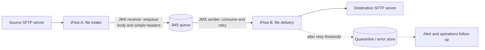

# File-to-file integration with JMS

## Summary and assumptions

This design uses SAP Cloud Integration (Cloud Integration) to copy files asynchronously from a source file server to a destination file server, with JMS buffering and retry between the two transfers.

Assumptions:

- The source and destination are SFTP servers; replace either adapter with the required file protocol after confirming its adapter capabilities.
- The source file should be acknowledged after it has been durably queued, not after delivery to the destination.
- The destination must tolerate a retry of the same file, or provide an agreed duplicate-detection mechanism.
- File contents are passed unchanged. Add format validation or transformation only when required.

## Architecture

JMS separates source availability from destination availability. The source iFlow completes when the message is accepted by JMS; destination delivery is a separate processing lifecycle.

## iFlow A — File intake and enqueue

1. **Sender:** Configure the SFTP sender to poll the agreed inbound directory and file-name pattern.
2. **File identity:** Set `SAP_ApplicationID` to a stable, unique file identity for monitoring. Do not use the basename alone if the source can reuse file names; include a source identity and a stable business key or other agreed file-instance discriminator.
3. **Target file name:** Retain the source file name in the `CamelFileName` header if it is suitable as the destination name. If renaming is required, set the agreed destination name before enqueueing. Validate names against the destination naming policy.
4. **JMS receiver:** Send the unchanged file body and required simple-typed headers to a dedicated queue, for example `Q_FILE_TO_FILE`.
5. **Properties:** Do not rely on exchange properties surviving the JMS hop. Keep the required file identity and name in simple-typed headers or the body. Leave **Transfer Exchange Properties** disabled.
6. **Source post-processing:** Configure source-side post-processing only after successful processing/enqueue, using the options supported by the selected sender adapter. Retain or move rejected files for operator recovery.

Expected result: the producer message is **Completed** after successful enqueue. This confirms queue acceptance, not destination delivery.

## iFlow B — JMS consumption and file delivery

1. **Sender:** Configure a JMS sender on `Q_FILE_TO_FILE`. Use a **Non-Exclusive** queue if the design will route on `SAPJMSRetries`.
2. **Retry:** Configure the JMS sender retry interval and backoff. Set an operationally appropriate message expiry/retention policy; without a stop condition, a permanently failing message can continue retrying until it expires.
3. **File receiver:** Configure the SFTP receiver for the destination directory. Use `CamelFileName` as the target file name when preserving or explicitly setting that header is the agreed naming strategy.
4. **Successful completion:** Let the flow complete only after the destination write succeeds.
5. **Failure handling:** Let delivery errors fail the JMS processing attempt so the JMS sender can retry. Do not end an Exception Subprocess with a normal Message End event for a delivery failure unless the flow has deliberately and durably quarantined the file; a Message End reports **Completed** in Monitor.
6. **Poison messages:** For a Non-Exclusive queue, use `SAPJMSRetries` in the Exception Subprocess to detect the agreed retry threshold. Once exceeded, persist the full file and diagnostic metadata to a controlled quarantine/error destination, alert operations, and only then complete the main-queue processing so the poison message stops cycling. Alternatively, configure and operate the JMS dead-letter queue for poison messages. Do not silently discard a message.

The JMS sender starts a JMS transaction when consuming a queue. **Required for JMS** is not needed just to read and deliver one message. If the flow writes multiple JMS messages that must commit or roll back together, configure transaction handling deliberately; a JMS transaction does not make a remote SFTP write atomic with JMS.

## Delivery guarantees and duplicate handling

- Delivery is **at least once**, not exactly once. If the destination commits a file but the acknowledgment is lost, the JMS message can be retried and the file can be written again.
- Use a deterministic destination name and agree on collision behavior (overwrite, reject, or version). If the target server and chosen adapter support a safe temporary-file-and-rename pattern, use it to avoid readers observing partial files.
- If overwriting is unsafe, add receiver-side duplicate detection or a reconciliation process based on the stable file identity. An iFlow idempotency check alone cannot eliminate the uncertain-outcome case where the destination commits but CPI does not receive the acknowledgment.
- There is no single atomic transaction spanning source-file post-processing, the JMS queue, and destination SFTP. Test recovery around each boundary and retain enough source/quarantine data to replay safely.

## Security, operations, and sizing

- Store SFTP credentials in tenant Security Material; externalize environment-specific directory paths and adapter configuration.
- Keep headers small and non-sensitive. JMS carries headers only when they are simple-typed, and the total headers and properties saved to JMS must remain within the documented 4 MB limit. Keep the file payload in the message body.
- Monitor the queue depth, oldest-message age, retry count, and quarantine volume. Check **Monitor → Manage Stores → Message Queues** and tenant JMS limits before sizing the queue or enabling high-volume polling.
- Avoid logging full file payloads. Include the stable file identity and source/target location in operational diagnostics.

## Verification in a tenant

1. Deploy both iFlows and confirm the JMS queue is available.
2. Place one valid test file in the source directory. Verify it is accepted/marked according to the source post-processing policy, the JMS queue drains, the destination file matches the source, and both producer and successful consumer messages are **Completed**.
3. Stop or deny access to the destination temporarily. Verify the consumer message is retried, the queue retains the message, and the source file is not silently lost. Restore access and confirm delivery.
4. Test a retry of a file whose destination write succeeded but whose acknowledgment is uncertain. Confirm the agreed overwrite/deduplication behavior.
5. Test a permanently invalid or unauthorized destination case. Verify retry-threshold or dead-letter handling retains the file, creates an alert/operations signal, and removes it from the main queue only after durable quarantine.
6. Confirm the queue remains within tenant storage limits and that replay from quarantine is documented.

## SAP references

- [JMS sender configuration and retry](https://github.com/SAP-docs/btp-integration-suite/blob/main/docs/ISuite_Integrations_APIs/configure-the-jms-sender-adapter-161791b.md)
- [JMS receiver configuration](https://github.com/SAP-docs/btp-integration-suite/blob/main/docs/ISuite_Integrations_APIs/configure-the-jms-receiver-adapter-79edc04.md)
- [JMS transaction handling characteristics and restrictions](https://github.com/SAP-docs/btp-integration-suite/blob/main/docs/ISuite_Integrations_APIs/transaction-handling-characteristics-and-restrictions-2388efb.md)
- [Headers and exchange properties](https://github.com/SAP-docs/btp-integration-suite/blob/main/docs/ISuite_Integrations_APIs/about-headers-and-exchange-properties-0974c4f.md)
- [Idempotency and receiver duplicate risk](https://github.com/SAP-docs/btp-integration-suite/blob/main/docs/ISuite_Integrations_APIs/receiver-isn-t-idempotent-5955d3f.md)
